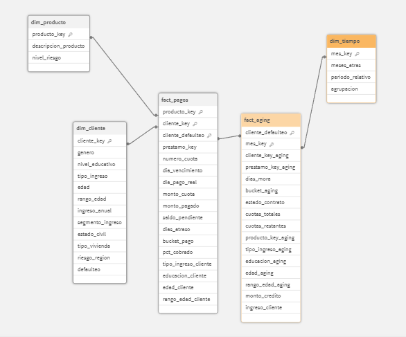
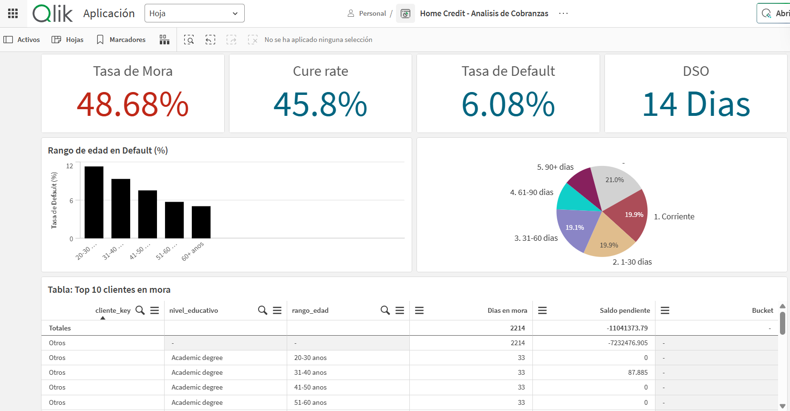
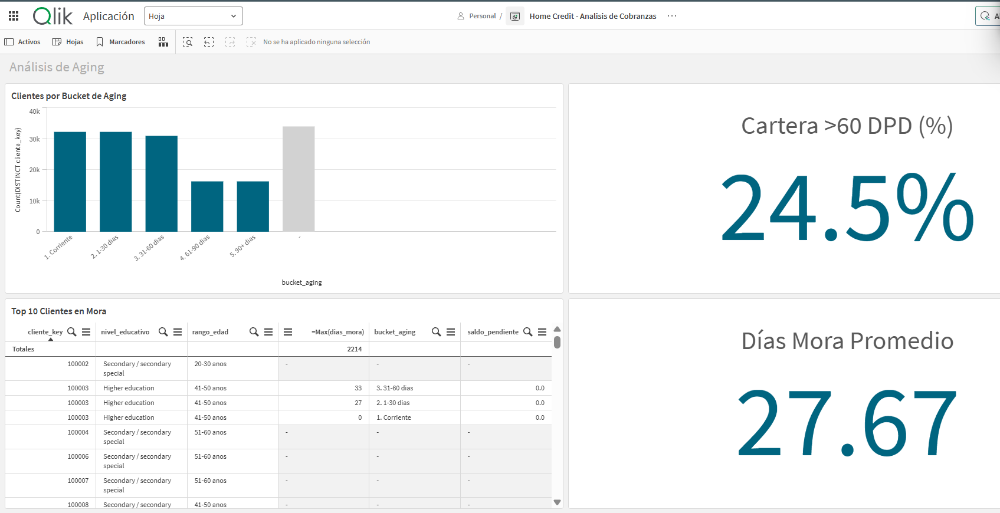
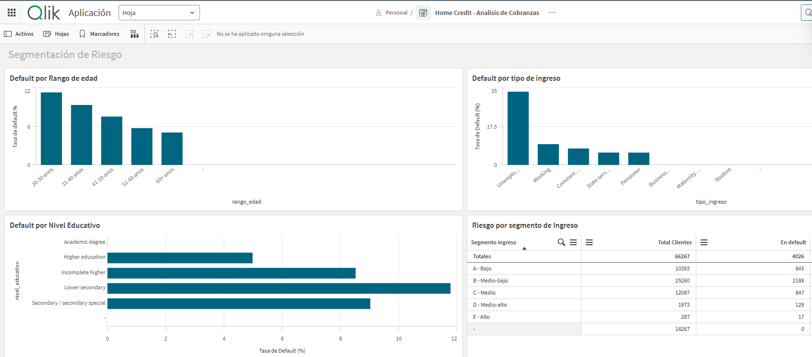
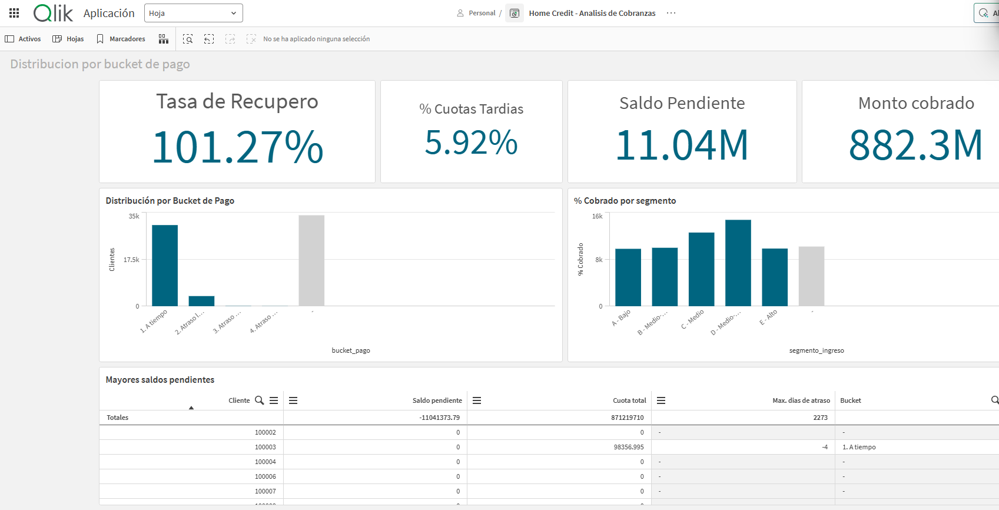
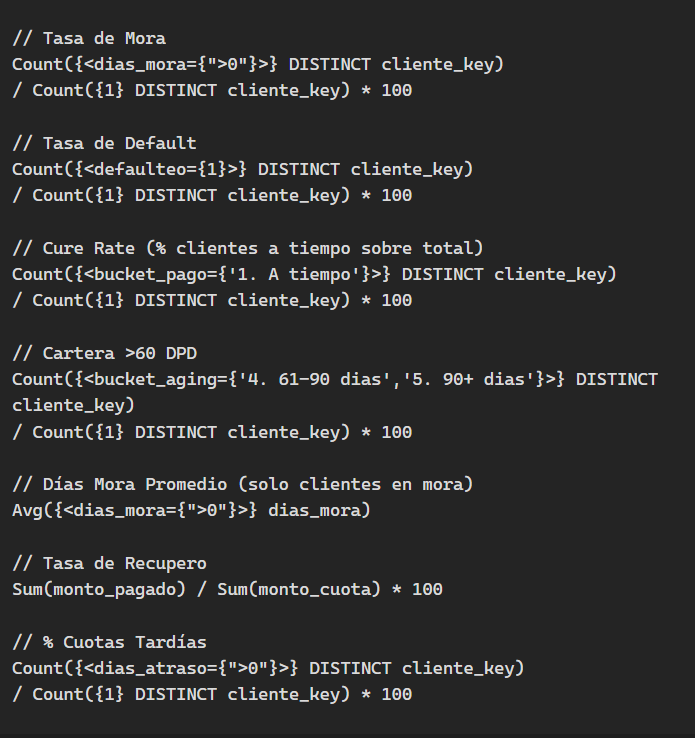

# Análisis de Cobranzas — Home Credit Default Risk

**Proyecto de práctica profesional de BI & Data Analytics**
**Autor:** Víctor Toro | **Stack:** Python · SQL · Supabase · Qlik Sense Cloud

---

## Descripción

Proyecto que simula el trabajo de un analista de datos en una empresa financiera de crédito al consumo, utilizando el dataset público **Home Credit Default Risk** de Kaggle. Cubre el ciclo completo: **ETL → Base de datos → Star Schema → Análisis SQL → Dashboard BI**.

**Pregunta de negocio que guía el proyecto:**
> "Quiero ver de un vistazo si estamos mejor o peor. El número que más me importa es cuántos clientes están con más de 60 días de atraso. Necesito saber qué tipo de cliente mora más y si mis gestores están trabajando bien." — *Gerente de Cobranzas (simulación)*

---

## Stack Tecnológico

| Herramienta | Rol |
|---|---|
| **Kaggle** (Home Credit dataset) | Fuente de datos |
| **Supabase (PostgreSQL)** | Base de datos en la nube, ETL y transformaciones |
| **Python** (pandas, SQLAlchemy, dotenv) | Scripts de carga y análisis |
| **SQL** | Queries de modelado y análisis en 5 bloques temáticos |
| **Qlik Sense Cloud** | Dashboard de 4 páginas con Set Analysis |

---

## Estructura del Proyecto

```
analisis-cobranzas-home-credit/
├── src/
│   ├── 01_cargar_datos.py        ← Carga los 7 CSV raw a Supabase (50k filas c/u)
│   ├── 02_modelado.py            ← Construye el Star Schema (3 dims + 2 facts)
│   ├── 03_analisis_segmentacion.py ← 8 queries de análisis (bloques 3, 4 y 5)
│   ├── 04_exportar_qlik.py       ← Exporta las tablas mart a CSV para Qlik
│   └── 05_verificar.py           ← Verifica tablas cargadas en Supabase
├── qlik_data/                    ← CSVs de salida (generados por 04_exportar_qlik.py)
│   ├── dim_cliente.csv
│   ├── dim_producto.csv
│   ├── dim_tiempo.csv
│   ├── fact_pagos.csv
│   └── fact_aging.csv
├── data/                         ← Carpeta para los CSV raw de Kaggle (no incluidos)
│   └── .gitkeep
├── .env.example                  ← Plantilla de variables de entorno
├── requirements.txt
└── README.md
```

---

## Screenshots del Dashboard

### Modelo de Datos en Qlik Sense (Star Schema)


### Página 1 — Resumen Ejecutivo


### Página 2 — Análisis de Aging


### Página 3 — Segmentación de Riesgo


### Página 4 — Comportamiento de Pago


### Medidas Qlik (Set Analysis)


---

## Instrucciones de Uso

### 1. Requisitos previos

```bash
pip install -r requirements.txt
```

### 2. Configurar credenciales

```bash
cp .env.example .env
# Editar .env con la URL de tu proyecto Supabase
```

### 3. Descargar el dataset

Descargar desde Kaggle: **Home Credit Default Risk**
Colocar los 7 archivos CSV en la carpeta `data/` y actualizar `DATA_PATH` en `.env`.

### 4. Ejecutar en orden

```bash
python src/01_cargar_datos.py     # Carga datos raw a Supabase
python src/02_modelado.py         # Crea el Star Schema
python src/03_analisis_segmentacion.py  # Ejecuta las 8 queries de análisis (bloques 3, 4 y 5)
python src/04_exportar_qlik.py    # Exporta tablas mart a CSV
python src/05_verificar.py        # Verifica todo
```

---

## Modelo de Datos — Star Schema

```
         dim_tiempo (93 períodos)
              │ mes_key
              │
dim_producto ─┼─── fact_aging ──── dim_cliente
producto_key  │    (50k filas)     cliente_key
              │
              └─── fact_pagos ──── dim_cliente
                   (50k filas)     cliente_key
```

### Tablas Raw (7 tablas, 50k filas c/u)

| Tabla | Contenido |
|---|---|
| `application_train` | Clientes con TARGET (defaulteó o no) |
| `bureau` | Historial crediticio externo |
| `bureau_balance` | Saldo mensual en buró |
| `previous_application` | Solicitudes anteriores en Home Credit |
| `credit_card_balance` | Saldo mensual de tarjetas |
| `pos_cash_balance` | DPD mensual por préstamo |
| `installments_payments` | Pagos reales vs. programados |

### Tablas Mart — Star Schema

| Tabla | Filas | Descripción |
|---|---|---|
| `dim_cliente` | 50.000 | Perfil: edad, educación, ingreso, segmento, default flag |
| `dim_producto` | 2 | Cash loans / Revolving loans |
| `dim_tiempo` | 93 | 93 períodos mensuales con agrupaciones |
| `fact_pagos` | 50.000 | Cuotas, atrasos, bucket de pago, % cobrado |
| `fact_aging` | 50.000 | DPD por período, bucket aging, estado contrato |

---

## Resultados del Análisis

### KPIs Principales

| Métrica | Valor |
|---|---|
| Tasa de mora activa | 1.57% |
| Cure Rate | 83.33% |
| Cuotas pagadas tarde | 8.61% |
| Atraso promedio | 13.9 días |
| Total facturado | $871.2M |
| Total cobrado | $882.3M |
| Tasa de recupero | ~101% (prepagos incluidos) |

### 5 Hallazgos Ejecutivos

1. **Jóvenes defaultean al doble** — 20-30 años: 11.3% vs. 60+: 5.1%
2. **Educación como predictor** — Sin estudios: 11.77% vs. universitarios: 4.98%
3. **Cure Rate 83%** — La gestión temprana funciona: foco en bucket 1-30 días
4. **8.61% cuotas tardías, 14 días promedio** — Automatizar recordatorio en día 7
5. **Buró con mora leve = 3.4× más riesgo** — Exigir historial en originación

### Default por Rango de Edad

| Rango | Tasa Default |
|---|---|
| 20-30 años | **11.32%** |
| 31-40 años | 9.1% |
| 41-50 años | 7.8% |
| 51-60 años | 6.5% |
| 60+ años | 5.06% |

### Default por Nivel Educativo

| Educación | Tasa Default |
|---|---|
| Secondary / secondary special incompleto | **11.77%** |
| Secondary / secondary special | 10.2% |
| Higher education | 4.98% |
| Academic degree | ~1% |

### Aging de Cartera

| Bucket DPD | Clientes | % |
|---|---|---|
| Corriente (0 días) | 42.051 | 98.43% |
| 1-30 días | 620 | 1.45% |
| 31-60 días | 15 | 0.04% |
| 61-90 días | 7 | 0.02% |
| 90+ días | 30 | 0.07% |

---

## Dashboard Qlik Sense Cloud

**App:** Home Credit — Analisis de Cobranzas

### Estructura de 4 páginas

| Página | Contenido |
|---|---|
| **P1 — Resumen Ejecutivo** | KPIs: Tasa de Mora, Cure Rate, Default, DSO; Barras por edad; Donut aging; Top 10 clientes |
| **P2 — Análisis de Aging** | Cartera >60 DPD, Mora Promedio; Barras por bucket; Top 10 en mora |
| **P3 — Segmentación de Riesgo** | Default por edad, educación, tipo de ingreso; Tabla por segmento |
| **P4 — Comportamiento de Pago** | Tasa de Recupero, % Cuotas Tardías, Saldo Pendiente, Monto Cobrado |

### Medidas Qlik (Set Analysis)

```qlik
// Tasa de Mora
Count({<dias_mora={">0"}>} DISTINCT cliente_key)
/ Count({1} DISTINCT cliente_key) * 100

// Tasa de Default
Count({<defaulteo={1}>} DISTINCT cliente_key)
/ Count({1} DISTINCT cliente_key) * 100

// Cure Rate
Count({<bucket_pago={'1. A tiempo'}>} DISTINCT cliente_key)
/ Count({1} DISTINCT cliente_key) * 100

// Cartera >60 DPD
Count({<bucket_aging={'4. 61-90 dias','5. 90+ dias'}>} DISTINCT cliente_key)
/ Count({1} DISTINCT cliente_key) * 100

// Tasa de Recupero
Sum(monto_pagado) / Sum(monto_cuota) * 100
```

---

## Recomendaciones del Analista

1. **Segmentar la gestión por edad y educación** — priorizar 20-30 años con educación secundaria incompleta (mayor concentración de riesgo)
2. **Alertas tempranas a los 30 DPD** — solo el 0.09% de la cartera supera los 60 días, pero el 1.45% ya está en el tramo 1-30; actuar en el primer tramo previene que escale
3. **Revisar política para desempleados** — tasa de default del ~33% justifica requisitos adicionales
4. **Modelo predictivo de scoring** — las variables disponibles (edad, educación, tipo ingreso, buró) son suficientes para Random Forest / XGBoost
5. **Revisar saldos negativos** — el campo `saldo_pendiente` presenta valores negativos que indican pagos en exceso o error en ETL

---

## Próximos Pasos

- [ ] Modelo predictivo de default en Python (Random Forest + XGBoost)
- [ ] Panel de filtros global en Qlik (todas las páginas)
- [ ] Conexión directa Qlik ↔ Supabase via conector PostgreSQL (eliminar CSVs intermedios)
- [ ] Revisión de expresión Mora Promedio por segmento
- [ ] Evolución temporal en Página 1 (requiere fechas reales)

---

## Dataset

- **Fuente:** [Home Credit Default Risk — Kaggle](https://www.kaggle.com/c/home-credit-default-risk)
- **Volumen:** ~350.000 registros en 7 tablas (se cargan 50.000 filas por tabla)
- Los archivos CSV del dataset **no están incluidos** en el repositorio por su tamaño.

---

*Proyecto de portafolio — BI & Data Analytics — Víctor Toro — 2026*
